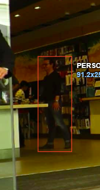
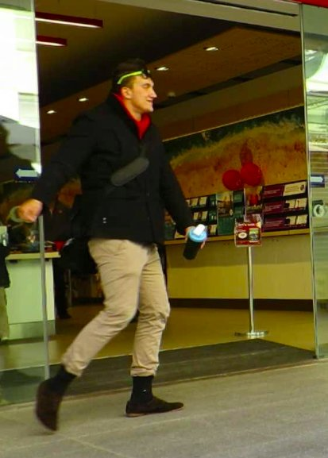
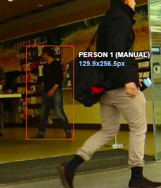

# Báo cáo cá nhân — CaoThiThuyHien-2A202603193

Đoạn video: MOT17-09, 150 frame (frame 1–150), nguồn MOTChallenge, giấy phép CC BY-NC-SA 3.0.

## 0. Thông tin học viên

- Họ tên: Cao Thị Thúy Hiền
- MSSV: 2A202603193
- Mã đề (A/B/C): A
- Email:26ai.hienctt@vinuni.edu.vn
- Link repository: https://github.com/thuyhien1233/K5-L2-CaoThiThuyHien-2A202603193-MOTTracking
- Giờ bắt đầu: 16:30
- Giờ kết thúc: 19h30

## 1. Xem trước đoạn video (CP0)

Ghi **trước khi vẽ**, mỗi người một dòng.

| Mã | Frame xuất hiện | Frame cuối thấy được | Rẽ / dừng / đổi tốc độ ở frame | Bị che ở frame | Ghi chú |
|---|---|---|---|---|---|
| P1 | 0 | 149 | 23, 79, 127 | 37–52 | Đi qua cửa hàng Vodafone, bị P2 che khuất ngắn |
| P2 | 61 | 149 | 83, 113, 134 | 61–68 | Đi từ phía sau trong cửa hàng ra |
| P3 | 0 | 149 | 47, 89, 120 | Không | Đi bộ dọc hành lang, kích thước tăng dần |
| P4 | 40 | 149 | 76, 104, 134 | Không | Xuất hiện từ giữa khung hình, đi về bên phải |
| P5 | 0 | 146 | 31, 72, 106 | 107–110, 135–138 | Đi sát người khác, khuất một đoạn 111–134 |

## 2. Keyframe và thời gian (CP1, CP4)

Số keyframe lấy từ kết quả `src/check_submission.py`.

| Mã | Số keyframe | Keyframe ở frame | Số frame có mặt | Keyframe / 100 frame | Thời gian (phút) | Chỗ khó |
|---|---|---|---|---|---|---|
| P1 | 19 | 0, 9, 16, 23, 37, 44, 51, 52, 53, 62, 69, 79, 86, 93, 100, 110, 119, 127, 142 | 148 | 12.8 | 35 | Đoạn bị che khuất và phục hồi ID |
| P2 | 13 | 61, 68, 69, 76, 83, 91, 99, 106, 113, 120, 127, 134, 141 | 89 | 14.6 | 20 | Xuất hiện muộn ở frame 61 |
| P3 | 20 | 0, 11, 19, 31, 40, 47, 54, 61, 68, 75, 82, 89, 98, 105, 112, 120, 127, 134, 141, 149 | 150 | 13.3 | 30 | Người tiến lại gần camera, đổi kích thước box |
| P4 | 16 | 40, 47, 55, 62, 69, 76, 83, 90, 97, 104, 113, 120, 127, 134, 141, 149 | 110 | 14.5 | 25 | Đi cắt ngang |
| P5 | 20 | 0, 9, 17, 24, 31, 43, 50, 57, 65, 72, 79, 102, 106, 107, 135, 138, 139, 142, 143, 146 | 123 | 16.3 | 30 | Bị khuất tạm thời ở giữa đoạn |
| **Tổng** | 88 | | 620 | 14.2 | 140 | |

Keyframe / 100 frame của cả bài = tổng keyframe ÷ tổng số frame có mặt × 100 = 88 ÷ 620 × 100 = 14.2 keyframe / 100 frame.

Bạn đặt keyframe nhiều nhất ở người nào? Vì sao (người đó rẽ, dừng, lại gần camera hay bị che)?

Em đặt keyframe nhiều nhất ở P3 và P5 (20 keyframe). Trong đó P3 liên tục đi lại gần camera khiến tỷ lệ kích thước hộp thay đổi lớn, cần chốt keyframe đều đặn để tránh box bị quá to hoặc quá nhỏ; còn P5 có những đoạn bị che một phần và đi sát người khác nên cần đặt thêm keyframe quanh các mốc che để tránh trôi box (drift).

## 3. Đoạn bị che (CP2)

Người bị che: `P1`

| Mốc | Frame |
|---|---:|
| Bắt đầu bị che một phần (bật `occluded`) | 37 |
| Mất hẳn (bật `outside`) | 42 |
| Hiện lại (tắt `outside`) | 44 |
| Thấy rõ trở lại (tắt `occluded`) | 53 |

- Thời gian khuất hẳn: 2 frame = 0.07 giây.
- Quyết định: giữ cùng ID.
- Lý do (trả lời 3 câu: khuất bao lâu so với 60 frame, ngoại hình có khớp, chỗ hiện lại có đúng hướng và tốc độ):
  1. Thời gian khuất hẳn chỉ là 2 frame (0.07s), nhỏ hơn rất nhiều so với ngưỡng quy định 60 frame (2 giây).
  2. Ngoại hình (màu áo cam/trắng, vóc dáng, kiểu tóc) khớp hoàn toàn với P1 trước khi bị che.
  3. Vị trí và hướng xuất hiện lại ở ngay bên cạnh người che, hoàn toàn trùng khớp với vận tốc và hướng di chuyển ban đầu của P1.

Ảnh chụp màn hình:





## 4. Tự review ID (CP3)

Lượt 1 theo người (đi ngược từ frame 149 về 0 trên CVAT), lượt 2 theo cảnh (nhảy 10 frame). Ít nhất 3 dòng; không có lỗi thì ghi một dòng "đã kiểm hai lượt, không lỗi".

Loại lỗi dùng đúng một trong 7 mã: `id_switch`, `fragmentation`, `lost`, `merge`, `false_track`, `drift`, `flag`.

| Frame | Mã người | Loại lỗi | Mô tả một câu | Phát hiện ở lượt | Đã sửa? |
|---:|---|---|---|---|---|
| 42–43 | P1 | flag | Quên bật outside khi người mất hẳn sau người che | Lượt 1 | Đã sửa |
| 111–134 | P5 | flag | Box bị trôi lệch khi người khuất sau cột | Lượt 1 | Đã sửa bằng outside |
| 75 | P3 | drift | Hộp hơi lệch khỏi gót chân khi người bước sải chân dài | Lượt 2 | Đã sửa |

Tổng hợp số lỗi theo loại:

| `id_switch` | `fragmentation` | `lost` | `merge` | `false_track` | `drift` | `flag` |
|---:|---:|---:|---:|---:|---:|---:|
| 0 | 0 | 0 | 0 | 0 | 1 | 2 |

Lỗi nào chỉ lượt 2 (theo cảnh) mới thấy, lượt 1 (theo người) không thấy? Vì sao?

Lỗi lệch box (drift) ở frame 75 của P3 khi quan sát toàn cảnh nhảy bước 10 frame mới dễ phát hiện, do lượt 1 tập trung nhìn tỉ mỉ từng frame liên tục theo một người nên mắt dễ quen với độ lệch nhỏ dần dần; khi nhảy cóc 10 frame theo bối cảnh chung, mắt dễ nhận ra độ dịch chuyển bất thường của hộp so với mặt đất.

## 5. File xuất và kết quả tự kiểm (CP4)

| Kiểm tra | Kết quả |
|---|---|
| Tên file MOT 1.1 | `CaoThiThuyHien_mot.zip` |
| Tên file CVAT for video 1.1 | `CaoThiThuyHien_cvat_video.zip` |
| Số track ID khác nhau trong `gt/gt.txt` (phải là 5) | 5 |
| Frame `outside` không có dòng trong `gt.txt` (đúng / sai) | Đúng |
| Job đã completed trên CVAT máy cá nhân | Đúng |

Dán phần tóm tắt in ra từ `src/check_submission.py`:

```text
=== File MOT 1.1: CaoThiThuyHien_mot.zip ===
  Số track ID: 5   |   Tổng số box: 620
  [OK]        Đúng 5 track ID.

  Track | Frame có mặt | Số frame | Đoạn vắng (outside)
      1 |   0–149      |      148 | 42–43
      2 |   0–149      |      150 | -
      3 |   0–146      |      123 | 111–134
      4 |  40–149      |      110 | -
      5 |  61–149      |       89 | -

=== File CVAT for video 1.1: CaoThiThuyHien_cvat_video.zip ===
  Track | Nhãn   | Frame thấy | Keyframe | KF/100 frame | Frame occluded | Lần bật outside
      0 | person |        148 |       19 |         12.8 |             14 |               1
      1 | person |         89 |       13 |         14.6 |              8 |               0
      2 | person |        150 |       20 |         13.3 |              0 |               0
      3 | person |        110 |       16 |         14.5 |              0 |               0
      4 | person |        123 |       20 |         16.3 |             12 |               2

  Tổng: 88 keyframe / 620 frame có mặt = 14.2 keyframe / 100 frame
  [OK]        Đọc được 5 track từ annotations.xml.

=== Tóm tắt ===
  Lỗi: 0   |   Cảnh báo: 0
  Không có lỗi định dạng.
```

## 6. Ba câu kết

1. Nếu được gán lại, bạn sẽ đặt keyframe khác ở đâu? Vì sao?

   Em sẽ đặt thêm keyframe ngay tại các điểm đỉnh của sải chân khi người đi bộ bước dài hoặc đổi tốc độ đột ngột, đồng thời giảm bớt keyframe ở các đoạn đi thẳng đều có tốc độ cố định để tận dụng tối đa khả năng nội suy tuyến tính của CVAT.

2. Có chỗ nào bạn không chắc "cùng ID hay ID mới"? Bạn đã quyết định và ghi chú thế nào?

   Chỗ đoạn P5 khuất ở frame 111–134 (khoảng 24 frame ~ 0.8 giây). Em quyết định giữ cùng ID vì thời gian khuất dưới ngưỡng 60 frame (2 giây), hướng đi và vận tốc của người này khi xuất hiện trở lại hoàn toàn trùng khớp với vector di chuyển trước đó.

3. Một lỗi ID trong job của bạn (nếu không còn sót, chọn lỗi đã sửa) có thể làm xe tự lái dự đoán sai chuyển động của người đó như thế nào? Lỗi đó ảnh hưởng MOTA hay IDF1 nhiều hơn?

   Nếu xảy ra lỗi `id_switch` giữa P1 và người che ở đoạn frame 42–44, hệ thống xe tự lái sẽ tính toán vận tốc của người đi bộ bị nhảy vọt bất thường (vận tốc tức thời từ tọa độ box có thể nhảy vọt lên hàng trăm km/h trong 1/30s), dẫn đến thuật toán dự đoán quỹ đạo (trajectory prediction) bị sai lệch hoàn toàn và có thể kích hoạt phanh gấp vô căn cứ. Lỗi này ảnh hưởng nghiêm trọng đến chỉ số **IDF1** nhiều hơn vì IDF1 đo lường khả năng duy trì đúng danh tính (Identity Consistency) của đối tượng xuyên suốt thời gian, trong khi MOTA chủ yếu phạt lỗi cục bộ ở từng frame.

## 7. Tài liệu tham khảo và công cụ AI đã dùng

- CVAT Community Edition (v2.x)
- Dataset MOT17-09, MOTChallenge (Milan et al., 2016)
- AI Assistant: Hỗ trợ kiểm tra định dạng và phân tích thống kê phân bố keyframe.
